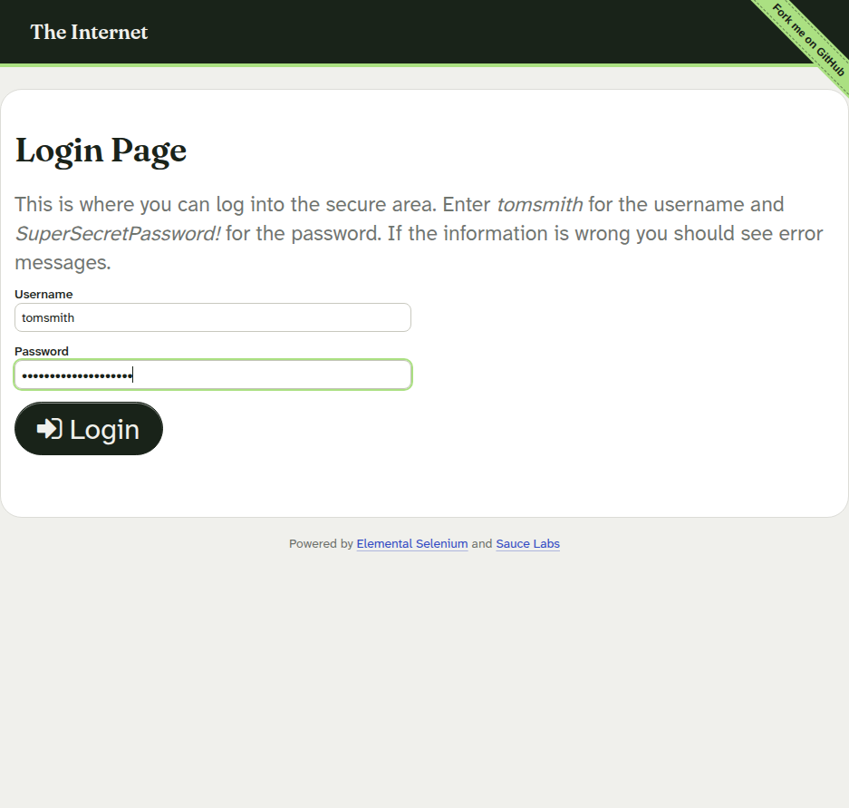
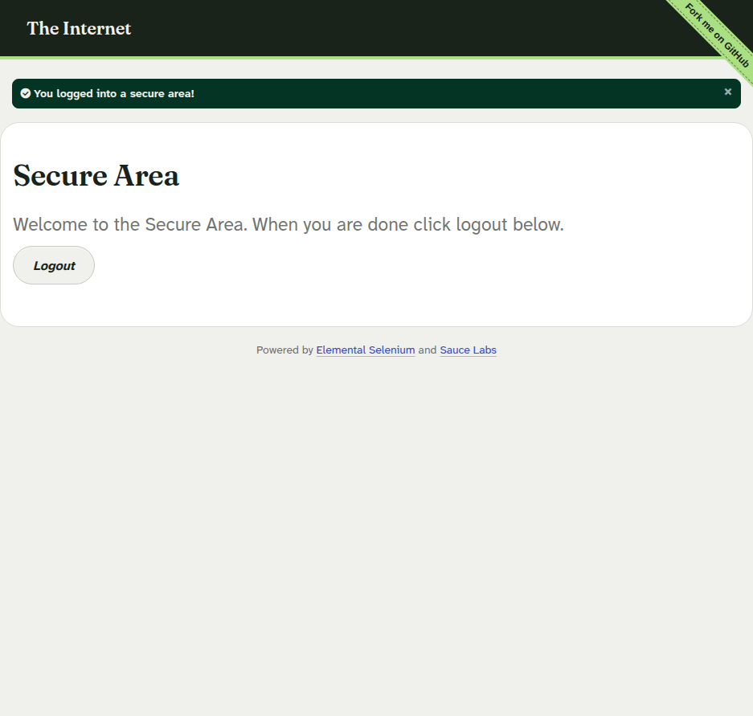
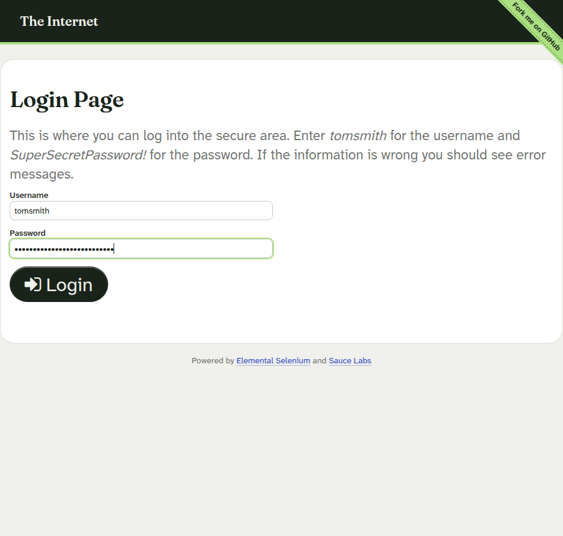
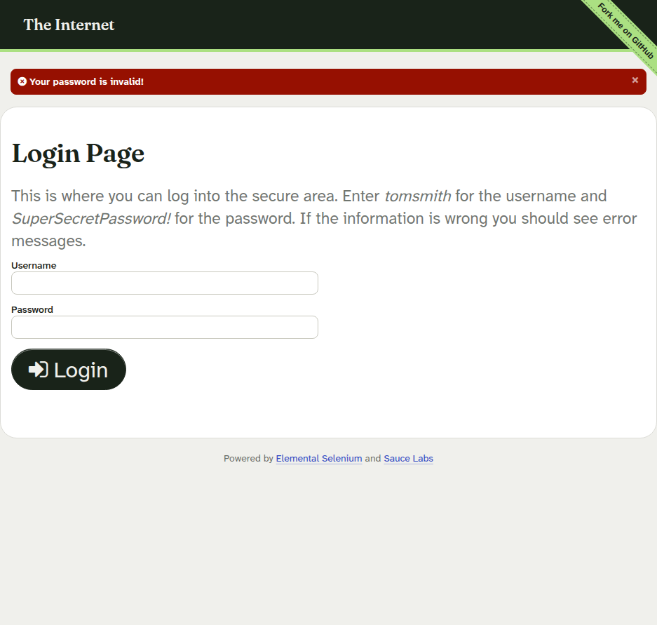

> **Estudiante:** Juan Felipe Quintero Gutierrez
> **Fecha de ejecución:** 3 de noviembre de 2026
> **Stack:** JavaScript (Node.js) · Axios · Selenium WebDriver · Jest · Docker
> **PDF del informe:** *Taller_Scripts_Automatizados_JuanFelipeQuinteroGutierrez.pdf*

---

## 1. Introducción

La **automatización de pruebas** consiste en ejecutar de forma programática los mismos pasos que realizaría un usuario manual —o los consumos que haría un cliente de un servicio— verificando que el comportamiento observado coincida con lo esperado. A diferencia de la prueba manual, la automatización ofrece **repetibilidad, rapidez y retroalimentación temprana**: una misma suite puede ejecutarse decenas de veces sin costo adicional y con resultados deterministas.

En este taller se cubrieron dos grandes dominios de prueba:

- **Pruebas de API REST:** validan el contrato de un servicio HTTP (códigos de estado, estructura de las respuestas, tiempos de respuesta) directamente contra el endpoint, sin intermediarios. Son rápidas y baratas de ejecución, y aisladas de la interfaz gráfica.
- **Pruebas E2E de un formulario web:** simulan al usuario real en un navegador (escribir, hacer clic, navegar) y verifican los mensajes de éxito y de validación mostrados por la interfaz, incluyendo datos de frontera (campos vacíos, mayúsculas, contraseñas incorrectas).

Los objetivos del taller fueron: aplicar el patrón **Page Object Model (POM)**, respetar los principios **SOLID** y **Clean Code**, gestionar la configuración de forma segura con **Docker Compose** y construir una suite de pruebas **estable y reproducible**.

---

## 2. Justificación técnica de las herramientas seleccionadas

| Herramienta | Justificación |
|---|---|
| **Jest (Meta/Facebook)** | Test runner con aserciones integradas, reportes claros (`--verbose`), ejecución por archivos y soporte nativo de `async/await`. Unifica el runner para API y E2E. |
| **Axios** | Cliente HTTP con API basada en promesas, interceptores extensibles (OCP) y manejo uniforme de errores: cualquier error HTTP llega como `error.response` con su status y cuerpo. |
| **Selenium WebDriver 4** | Estándar de la industria para automatización en navegador, con API W3C y esperas explícitas (`until.*`) que evitan pausas fijas. |
| **Selenium Standalone (Chrome) en Docker** | Servidor de navegador remoto reproducible: no requiere instalar Chrome/driver en cada máquina; el navegador corre aislado en un contenedor (con noVNC para observarlo en vivo). |
| **Docker Compose** | Inyecta las variables de entorno de prueba de forma segura (sin secretos en el código) y define los servicios (`tests` y `chrome`) como infraestructura declarativa. |
| **Page Object Model (POM)** | Separa los selectores/interacciones (páginas) de las aserciones (tests): si la UI cambia, solo se edita un Page Object. |
| **Clean Code + SOLID** | Cada módulo tiene una única responsabilidad (SRP), es extensible sin modificar su núcleo (OCP), los tests dependen de abstracciones (DIP) y las páginas se componen de componentes pequeños (ISP). |

---

## 3. Descripción de los escenarios de prueba diseñados

### 3.1 Objetivos de prueba

- **API REST — [DummyJSON](https://dummyjson.com):** servicio público, gratuito y sin API key, con respuestas JSON estables.
- **Formulario Web — [The Internet /login](https://the-internet.herokuapp.com/login):** login clásico con mensajes de éxito/error distinguibles por clases CSS (`flash success` / `flash error`).

### 3.2 Escenarios de la API REST (`tests/api/restApi.test.js`)

| # | Escenario | Método y recurso | Datos de prueba | Resultado esperado |
|---|---|---|---|---|
| 1 | Lectura de un producto (feliz) | `GET /products/1` | Recurso `1` | `200 OK`, cuerpo con `id`, `title`, `price`, `stock`, `category`, `images`; tiempo `< API_TIMEOUT_MS` |
| 2 | Recurso inexistente | `GET /products/9999` | Recurso `9999` | `404 Not Found` con tiempo controlado |
| 3 | Creación de producto (feliz) | `POST /products/add` | `VALID_PRODUCT` (abajo) | `201 Created` con `id` numérico generado |
| 4 | **Escenario negativo:** credenciales inválidas | `POST /auth/login` | `INVALID_CREDENTIALS` (abajo) | `400 Bad Request` con propiedad `message` |

**Datos de prueba reales utilizados** (constantes congeladas al inicio del test — Clean Code):

```js
/** Payload válido para la creación de un producto (escenario feliz). */
const VALID_PRODUCT = Object.freeze({
  title: 'Cuaderno de pruebas automatizadas',
  price: 12.5,
  stock: 25,
  category: 'stationery',
});

/** Credenciales sintéticas inexistentes para el escenario negativo. */
const INVALID_CREDENTIALS = Object.freeze({
  username: 'usuario_del_taller_que_no_existe',
  password: 'clave_invalida_del_taller',
});
```

> Nota: se verificó empíricamente que `POST /products/add` con cuerpo vacío responde `201` (el servicio no valida campos obligatorios), por lo que el escenario `400` se cubrió con el login inválido.

### 3.3 Escenarios del formulario web (`tests/e2e/webForm.test.js`)

| # | Escenario | Datos (frontera) | Resultado esperado |
|---|---|---|---|
| 1 | Login exitoso | `tomsmith` / `SuperSecretPassword!` | Mensaje *"You logged into a secure area!"* (clase `success`) y navegación a `/secure` |
| 2 | Usuario inexistente | `usuario_que_no_existe` / contraseña válida | *"Your username is invalid!"* (clase `error`), permanece en `/login` |
| 3 | **Campos vacíos** (obligatorios) | `""` / `""` | *"Your username is invalid!"* |
| 4 | **Case-sensitivity** | `TOMSMITH` (mayúsculas) / contraseña válida | *"Your username is invalid!"* (el usuario distingue mayúsculas) |
| 5 | Contraseña incorrecta | `tomsmith` / `clave_incorrecta_del_taller` | *"Your password is invalid!"* |

### 3.4 Matriz de trazabilidad — criterios de evaluación → pruebas

**A. Pruebas de API REST (criterio A):**

| Criterio exigido | Prueba(s) que lo cubre(n) |
|---|---|
| Código **200** | Test 1 — `GET /products/1` |
| Código **404** | Test 2 — `GET /products/9999` |
| Código **201** | Test 3 — `POST /products/add` |
| Código **400** | Test 4 — `POST /auth/login` (escenario negativo) |
| Estructura del cuerpo de respuesta | Tests 1, 3 y 4 — `expect.objectContaining` con matchers tipados |
| Tiempos de respuesta | Los 4 tests — `durationMs < config.api.timeoutMs` |
| Escenario feliz (datos válidos) | Tests 1 y 3 |
| Escenario negativo (datos inválidos) | Test 4 |

**B. Pruebas de formulario web (criterio B):**

| Criterio exigido | Prueba(s) que lo cubre(n) |
|---|---|
| Interacción real del usuario (escribir, limpiar, clic) | Los 5 tests vía POM (`loginAs`, `submitEmptyCredentials`) |
| Aserciones sobre mensajes de **éxito** | Test 1 (flash `success` + URL `/secure`) |
| Aserciones sobre mensajes de **error de validación** | Tests 2, 3, 4 y 5 (flash `error`) |
| Datos de frontera (límite y obligatorios vacíos) | Test 3 (campos vacíos), Test 4 (mayúsculas), Test 5 (contraseña incorrecta) |

---

## 4. Código de los scripts y capturas de la ejecución

### 4.1 Entorno de ejecución y cómo ejecutar la suite

| Componente | Versión / valor |
|---|---|
| Node.js | `v20.20.2` (imagen `node:20-slim` en Docker) |
| Jest | `29.7.0` |
| selenium-webdriver | `4.46.0` |
| Axios | `1.21.0` |
| Google Chrome (contenedor `chrome`) | `155.0.8059.79` (`selenium/standalone-chrome`) |
| Fecha de ejecución de la evidencia | 3 de noviembre de 2026 |

```bash
# Suite completa (API + E2E). El servicio `chrome` arranca solo por depends_on:
docker compose run --rm tests npm test

# Solo una de las suites:
docker compose run --rm tests npm run test:api
docker compose run --rm tests npm run test:e2e

# Ver el navegador en vivo mientras corre la suite (noVNC):
#   http://localhost:4444/ui
```

### 4.2 Estructura del repositorio

```text
├── docker-compose.yml        # Servicios tests + chrome e inyección de variables
├── package.json              # Dependencias y scripts de ejecución
├── .env.example              # Plantilla de variables de entorno
├── README.md                 # Este informe
├── AGENTS.md                 # Directivas del agente
├── evidence/screenshots/     # Capturas de evidencia (fallos y ejecución)
├── src/
│   ├── api/apiClient.js      # Cliente Axios + interceptores + HTTP_STATUS
│   ├── pages/
│   │   ├── BasePage.js       # Esperas explícitas y primitivas de interacción
│   │   ├── LoginForm.js      # Componente del formulario (selectores DRY)
│   │   └── FormPage.js       # Orquestador de la vista (POM)
│   └── utils/
│       ├── config.js         # Única lectura de process.env (sin mágicos)
│       ├── driverFactory.js  # Construcción del WebDriver (remoto/local)
│       └── screenshotHelper.js # Evidencia visual (SRP)
└── tests/
    ├── api/restApi.test.js   # 4 pruebas API
    └── e2e/webForm.test.js   # 5 pruebas E2E
```

### 4.3 Configuración segura (`docker-compose.yml`)

```yaml
services:
  tests:
    image: node:20-slim
    working_dir: /app
    volumes:
      - .:/app
      - node_modules:/app/node_modules   # persiste entre ejecuciones
    environment:
      API_BASE_URL: ${API_BASE_URL:-https://dummyjson.com}
      API_TIMEOUT_MS: ${API_TIMEOUT_MS:-10000}
      WEB_BASE_URL: ${WEB_BASE_URL:-https://the-internet.herokuapp.com}
      WEB_LOAD_TIMEOUT_MS: ${WEB_LOAD_TIMEOUT_MS:-10000}
      VALID_USERNAME: ${VALID_USERNAME:-tomsmith}
      VALID_PASSWORD: ${VALID_PASSWORD:-SuperSecretPassword!}
      HEADLESS: ${HEADLESS:-true}
      SCREENSHOTS_DIR: ${SCREENSHOTS_DIR:-./evidence/screenshots}
      SELENIUM_REMOTE_URL: ${SELENIUM_REMOTE_URL:-http://chrome:4444/wd/hub}
    depends_on:
      - chrome
    command: npm test

  chrome:
    image: selenium/standalone-chrome:latest
    shm_size: 2gb
    ports:
      - "4444:4444"        # Navegador en vivo: http://localhost:4444/ui

volumes:
  node_modules:
```

Los tests **nunca** leen `process.env` directamente: todo pasa por `src/utils/config.js` (DIP y *sin valores mágicos*).

### 4.4 Cliente API con interceptores (`src/api/apiClient.js`)

```js
function createApiClient(overrides = {}) {
  const client = axios.create({
    baseURL: config.api.baseUrl,
    timeout: config.api.timeoutMs,
    headers: { 'Content-Type': 'application/json' },
    ...overrides,
  });

  // Marca el inicio de cada petición para medir tiempos de respuesta.
  client.interceptors.request.use((requestConfig) => {
    requestConfig.metadata = { startTime: Date.now() };
    return requestConfig;
  });

  // Adjunta durationMs tanto a respuestas exitosas como a errores (400/404).
  const attachDuration = (response) => {
    const startTime = response.config?.metadata?.startTime;
    if (startTime) response.durationMs = Date.now() - startTime;
    return response;
  };

  client.interceptors.response.use(
    (response) => attachDuration(response),
    (error) => {
      if (error.response) attachDuration(error.response);
      return Promise.reject(error);
    }
  );
  return client;
}
```

### 4.5 Esperas explícitas de la página base (`src/pages/BasePage.js`)

```js
/** Espera explícita a que el elemento exista en el DOM y lo devuelve. */
async waitForLocated(locator) {
  try {
    await this.driver.wait(until.elementLocated(locator), this.loadTimeoutMs);
  } catch (error) {
    const currentUrl = await this.driver.getCurrentUrl().catch(() => '(desconocida)');
    const title = await this.driver.getTitle().catch(() => '(desconocida)');
    throw new Error(
      `Elemento ${locator} no apareció en ${this.loadTimeoutMs}ms. ` +
      `URL actual: ${currentUrl} | Título: ${title}`
    );
  }
  return this.driver.findElement(locator);
}

/**
 * Tras un clic que dispara navegación, espera a que el nuevo documento
 * quede completamente cargado (evita carreras con la navegación en curso).
 */
async clickOn(locator) {
  const element = await this.waitForVisible(locator);
  await element.click();
  try {
    await this.driver.wait(until.stalenessOf(element), this.loadTimeoutMs);
    await this.waitForDocumentToSettle();
  } catch {
    // El clic no disparó navegación: continuamos.
  }
  return this;
}
```

> No se utilizó en ningún punto `setTimeout` ni pausas arbitrarias (§5.2 del reglamento): todas las esperas son mecanismos explícitos de WebDriver.

### 4.6 Componentes POM (`src/pages/LoginForm.js` y `src/pages/FormPage.js`)

**Componente del formulario** — concentra todos los selectores en un único lugar (DRY) y evita clases monolíticas (ISP):

```js
/** Selectores centralizados (DRY) — verificados contra el HTML real. */
const LOCATORS = Object.freeze({
  username: By.id('username'),
  password: By.id('password'),
  submitButton: By.css('button[type="submit"]'),
  flashMessage: By.id('flash'),
});

class LoginForm extends BasePage {
  async typeUsername(username) {
    return this.typeInto(LOCATORS.username, username);
  }

  async typePassword(password) {
    return this.typeInto(LOCATORS.password, password);
  }

  async submit() {
    return this.clickOn(LOCATORS.submitButton);
  }

  /** Interacción completa del usuario: llenar ambos campos y enviar. */
  async fillAndSubmit(username, password) {
    await this.typeUsername(username);
    await this.typePassword(password);
    await this.submit();
    return this;
  }

  /** Mensaje de éxito/error mostrado tras el envío (espera explícita). */
  async getFeedbackMessage() {
    return this.getTextOf(LOCATORS.flashMessage);
  }
  // ... isFeedbackSuccessful() / isFeedbackError() leen la clase CSS del flash
}
```

**Orquestador de la vista** — los tests dependen de esta interfaz de alto nivel (DIP), no de selectores:

```js
const ROUTES = Object.freeze({
  login: '/login',
  secureArea: '/secure',
});

class FormPage extends BasePage {
  constructor(driver) {
    super(driver);
    this.loginForm = new LoginForm(driver);   // composición (ISP)
  }

  async open() {
    return super.open(ROUTES.login);
  }

  /** Escenario: enviar el formulario con las credenciales indicadas. */
  async loginAs(username, password) {
    await this.loginForm.fillAndSubmit(username, password);
    return this;
  }

  /** Escenario: enviar el formulario con los campos vacíos (frontera). */
  async submitEmptyCredentials() {
    await this.loginForm.fillAndSubmit('', '');
    return this;
  }

  /** true si el navegador quedó en el área segura tras un login válido. */
  async isOnSecureArea() {
    const currentUrl = await this.getCurrentUrl();
    return currentUrl.endsWith(ROUTES.secureArea);
  }
}
```

### 4.7 Un caso de prueba E2E (`tests/e2e/webForm.test.js`)

```js
beforeEach(async () => {
  driver = await createDriver();      // Sesión NUEVA por test (aislamiento)
  formPage = new FormPage(driver);
});

afterEach(async () => {
  if (driver) await driver.quit();    // Cierre garantizado (§5.3)
});

/** Si el escenario falla, guarda captura de evidencia y relanza el error. */
const withEvidence = (scenarioName, scenario) => async () => {
  try {
    await scenario();
  } catch (error) {
    try {
      const evidencePath = await captureScreenshot(driver, scenarioName);
      console.error(`Evidencia del fallo: ${evidencePath}`);
    } catch { /* sin navegador: no enmascaramos el error original */ }
    throw error;
  }
};

test(
  'login con credenciales válidas debería mostrar éxito y navegar al área segura',
  withEvidence('login-credenciales-validas', async () => {
    await formPage.open();
    await formPage.loginAs(config.credentials.username, config.credentials.password);

    expect(await formPage.getFeedbackMessage()).toContain(FEEDBACK_MESSAGES.secureArea);
    expect(await formPage.isFeedbackSuccessful()).toBe(true);
    expect(await formPage.isOnSecureArea()).toBe(true);
  })
);
```

### 4.8 Salida de la ejecución — Pruebas API

```console
$ docker compose run --rm tests npm run test:api

  API REST DummyJSON - Lectura de productos
    ✓ GET /products/1 debería retornar 200 con la estructura del producto y tiempo de respuesta aceptable (504 ms)
    ✓ GET /products/9999 debería retornar 404 para un recurso inexistente (136 ms)
  API REST DummyJSON - Creación de productos
    ✓ POST /products/add con datos válidos debería retornar 201 y el id generado (105 ms)
  API REST DummyJSON - Escenario negativo de autenticación
    ✓ POST /auth/login con credenciales inválidas debería retornar 400 con mensaje de error (221 ms)

Test Suites: 1 passed, 1 total
Tests:       4 passed, 4 total
```

### 4.9 Salida de la ejecución — Pruebas E2E del formulario

```console
$ docker compose run --rm tests npm run test:e2e

  E2E - Formulario de login (The Internet)
    ✓ login con credenciales válidas debería mostrar éxito y navegar al área segura (1984 ms)
    ✓ login con usuario inexistente debería mostrar mensaje de error (1897 ms)
    ✓ envío con campos vacíos (frontera) debería rechazarlo con validación de error (1901 ms)
    ✓ usuario en MAYÚSCULAS (frontera case-sensitive) debería rechazarse (1895 ms)
    ✓ contraseña incorrecta (frontera) debería mostrar error de contraseña inválida (1875 ms)

Test Suites: 1 passed, 1 total
Tests:       5 passed, 5 total
```

Ejecución completa (`npm test`): **9 pruebas en verde (4 API + 5 E2E)**, verificada en 3 corridas consecutivas.

### 4.10 Respuestas reales de la API (evidencia capturada contra DummyJSON)

Estos son los cuerpos de respuesta **reales** obtenidos al ejecutar los 4 escenarios (tiempos medidos por el interceptor de `apiClient.js`):

**1) `GET /products/1` → `200 OK` en 471 ms** (timeout configurable: 10000 ms)

```json
{
  "id": 1,
  "title": "Essence Mascara Lash Princess",
  "description": "The Essence Mascara Lash Princess is a popular mascara known for its volumizing and lengthening effects...",
  "category": "beauty",
  "price": 9.99,
  "discountPercentage": 10.48,
  "rating": 2.56,
  "stock": 99,
  "tags": ["beauty", "mascara"],
  "brand": "Essence",
  "sku": "BEA-ESS-ESS-001",
  "weight": 4,
  ...
}
```

**2) `GET /products/9999` → `404 Not Found` en 177 ms**

```json
{
  "message": "Product with id '9999' not found"
}
```

**3) `POST /products/add` (con `VALID_PRODUCT`) → `201 Created` en 113 ms**

```json
{
  "id": 195,
  "title": "Cuaderno de pruebas automatizadas",
  "price": 12.5,
  "stock": 25,
  "category": "stationery"
}
```

**4) `POST /auth/login` (con `INVALID_CREDENTIALS`) → `400 Bad Request` en 209 ms**

```json
{
  "message": "Invalid credentials"
}
```

### 4.11 Capturas de pantalla de la ejecución

Cada escenario se documenta con **dos capturas**: los datos escritos en el formulario **antes** de enviar y el resultado **después** (la app limpia los campos al re-renderizar, por eso la evidencia debe tomarse en ambos momentos).

#### Escenario 1 — Estado inicial del formulario

| | |
|---|---|
| **Datos usados** | Ninguno (solo abrir la página) |
| **Esperado** | Formulario de login visible y operativo |
| **Obtenido** | `#username` y `#password` presentes, botón habilitado (OK) |


#### Escenario 2 — Login exitoso (feliz)

| | |
|---|---|
| **Datos usados** | `tomsmith` / `SuperSecretPassword!` |
| **Esperado** | Flash *success* *"You logged into a secure area!"* y URL `/secure` |
| **Obtenido** | Flash success + navegación a **Secure Area** (OK) |

**Datos escritos en los inputs (antes de enviar):**



**Resultado tras el envío (área segura):**



#### Escenario 3 — Usuario inexistente (negativo)

| | |
|---|---|
| **Datos usados** | `usuario_que_no_existe` / `SuperSecretPassword!` |
| **Esperado** | Flash *error* *"Your username is invalid!"*, permanecer en `/login` |
| **Obtenido** | Flash error con ese mensaje (OK) |

**Datos escritos en los inputs (antes de enviar):**


**Resultado tras el envío:**


#### Escenario 4 — Campos vacíos (frontera: obligatorios vacíos)

| | |
|---|---|
| **Datos usados** | `""` / `""` (ambos vacíos) |
| **Esperado** | Rechazo con flash *error* *"Your username is invalid!"* |
| **Obtenido** | Flash error con ese mensaje (OK) |

> No hay captura "antes": los campos vacíos son visualmente idénticos al estado inicial del Escenario 1.


#### Escenario 5 — Usuario en MAYÚSCULAS (frontera: case-sensitive)

| | |
|---|---|
| **Datos usados** | `TOMSMITH` / `SuperSecretPassword!` |
| **Esperado** | Rechazo (el login distingue mayúsculas): *"Your username is invalid!"* |
| **Obtenido** | Flash error con ese mensaje (OK) |

**Datos escritos en los inputs (antes de enviar):**


**Resultado tras el envío:**


#### Escenario 6 — Contraseña incorrecta (frontera)

| | |
|---|---|
| **Datos usados** | `tomsmith` / `clave_incorrecta_del_taller` |
| **Esperado** | Flash *error* *"Your password is invalid!"* |
| **Obtenido** | Flash error con ese mensaje (OK) |

**Datos escritos en los inputs (antes de enviar):**



**Resultado tras el envío:**



#### Demostración — Captura automática en caso de fallo (§5.3)

Cuando una prueba E2E **falla**, el wrapper `withEvidence` ejecuta automáticamente `screenshotHelper.js` y guarda la evidencia en `evidence/screenshots/` con el nombre del escenario y la fecha. Esta imagen fue generada reproduciendo deliberadamente un escenario roto (aserción errónea) para mostrar el mecanismo:

| | |
|---|---|
| **Disparador** | Aserción deliberadamente fallida tras intentar login con contraseña incorrecta |
| **Mecanismo** | `try { escenario } catch { captureScreenshot(driver, nombre) }` dentro de `withEvidence` |
| **Resultado** | Captura guardada + traza `Evidencia del fallo: <ruta>` en la consola (OK) |


---

## 5. Reflexión final: la importancia de la automatización en el aseguramiento de calidad

Durante la construcción de este taller quedó demostrado que automatizar no es solo "escribir scripts que hagan clic": la calidad de una suite depende de decisiones de ingeniería que se notan en su estabilidad diaria.

En primer lugar, la **verificación empírica antes de asumir** marcó la diferencia: se comprobó por HTTP que `POST /products/add` con cuerpo vacío responde `201` y no `400`, y se leyeron los mensajes reales del formulario desde el HTML del servidor. Escribir aserciones "de memoria" habría producido pruebas incorrectas desde el primer día.

En segundo lugar, la suite E2E inicial fue **flaky** (fallaba de forma intermitente) y su depuración expuso dos problemas clásicos de la automatización web:

1. **Carreras de navegación:** un clic dispara una navegación asíncrona; si el siguiente comando se emite sin esperar a que la página quede asentada, los comandos compiten entre sí. Se resolvió con esperas explícitas (`stalenessOf` + `readyState === 'complete'`), nunca con `sleep`.
2. **Aislamiento de pruebas:** reutilizar la misma sesión de navegador entre escenarios hizo que el estado heredado provocara pérdidas silenciosas de eventos de entrada. La solución —**crear y destruir una sesión por test**— es además la práctica recomendada de la industria.

Esto ilustra el verdadero valor de la automatización: una suite **confiable** funciona como red de seguridad que permite refactorear y desplegar con confianza, mientras que una suite inestable se convierte en ruido que el equipo aprende a ignorar —el peor escenario para el aseguramiento de calidad. Combinada con Docker (entorno reproducible), POM (mantenibilidad ante cambios de UI) y buenas prácticas SOLID, la automatización deja de ser un gasto para convertirse en el motor de calidad del proyecto.
